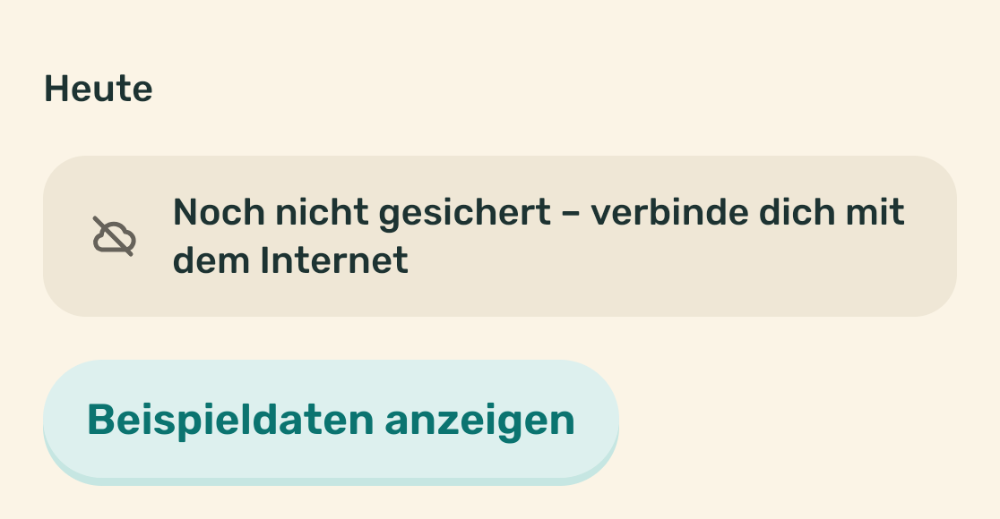
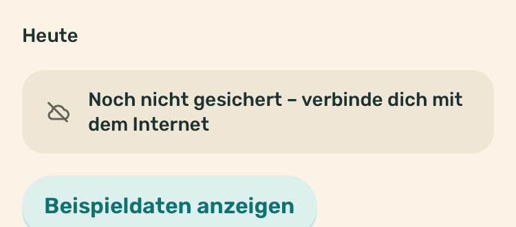

# #102 · Geräteprüfung des Sicherungshinweises (20.10.2026)

**Teilnachweis, kein Freigabevermerk.** Isolierter Development-Build `de.yggras.abnehmapp.ticket102` auf Fairphone 6 (Android 16) und iPhone SE (3. Generation). Andere installierte App-Varianten wurden nicht verändert. Backend und Metro liefen isoliert auf 8792 bzw. 8083. Die Build-Variante war ausschließlich eine lokale, anschließend zurückgenommene Änderung an `apps/mobile/app.config.ts`.

## Tatsächlich sichtbarer Hinweis · Fairphone 6

Die Bilder sind **Ausschnitte aus nativen ADB-Screenshots des physischen Geräts**, keine Browser- oder Komponenten-Renderings. Testzustand: Dev-Seed `solo`, gültig formatierte V3-Delete-Operation mit Erstellungszeit `2026-10-12T12:00:00.000Z` in der **isolierten Test-App-Datenbank**; das ebenfalls isolierte Backend wurde gestoppt, damit die Operation unbestätigt bleibt. Der Testzustand wurde für die Geräteprüfung direkt in die kopierte SQLite-Datenbank eingefügt (nicht durch eine Benutzeraktion). Danach wurde die App neu gestartet. Das Bild zeigt den tatsächlich von `engine.status()` über `syncStatusSource` und `SyncWarning` gerenderten Zustand `not_secured_since`, keine erzwungene UI-Mock-Antwort. Dies ist ein reproduzierter Diagnosezustand, **kein Nachweis für eine echte Offline-Benutzeränderung oder die spätere Bestätigung**. Die komplette native Originalaufnahme liegt lokal unter `/tmp/android102-warning.png`, das Original mit Schriftfaktor 2,0 unter `/tmp/android102-warning-scale2.png`.

Auf dem iPhone wurde derselbe separate Build erstellt, installiert und der Seed `solo` nach anfänglich nicht erreichbarem Backend erfolgreich geöffnet. Die ebenfalls isolierte SQLite-Datenbank wurde mit einem V3-Delete und Erstellungszeit `2026-10-12T12:00:00.000Z` vorbereitet. Der Wiederstart scheiterte zunächst an der Gerätesperre (`FBSOpenApplicationServiceErrorDomain`, `Locked`); nach dem Entsperren gelang der Start und die App zeigte **ebenfalls den tatsächlichen Hinweis**:

Das ist ein Ausschnitt aus `/tmp/ios102-warning2.png` (native `devicectl`-Bildschirmaufnahme); auch hier ein gezielt in der separaten Testdatenbank hergestellter Diagnosezustand, kein Nachweis einer realen Nutzeränderung. VoiceOver und Schriftfaktor 2,0 auf iOS bleiben offen.

## Impeccable critique · Ziel: „erkennen, dass Änderungen nicht gesichert sind, und wissen, was zu tun ist“

Method: design review only (detector not applicable, native platform). Ziel: `apps/mobile/src/shell/SyncWarning.tsx`; visuelle Grundlage: die drei oben gezeigten Aufnahmen beider Geräte. Auf iOS dieselbe Text-Hierarchie, ruhig platzierte Warnung und vollständig sichtbarer Text; ein iOS-Large-Text-Bild liegt nicht vor.

| Nielsen-Heuristik | Bewertung / 4 | Beobachtung |
| --- | ---: | --- |
| 1 Sichtbarkeit des Systemstatus | 4 | Oberhalb aller Heute-Inhalte sichtbar; ikonisch und sprachlich. |
| 2 Übereinstimmung mit der Realität | 2 | „Verbinde dich“ passt **nicht**, wenn bereits WLAN vorhanden ist, aber der Server ausfällt (hier bewusst reproduziert). |
| 3 Kontrolle und Freiheit | 2 | Kein sichtbarer Wiederholen-Knopf; Pull-to-Refresh ist nicht unmittelbar ersichtlich. |
| 4 Konsistenz | 3 | Nutzt die vorhandene `Notice`-Komponente, keine systemfremde Modalität. |
| 5 Fehlervermeidung | 3 | Nicht gesicherte Daten werden nicht als gesichert ausgegeben. |
| 6 Wiedererkennung statt Erinnerung | 3 | Text nennt das Problem und eine Aktion; Netz-/Serverursache wird nicht unterschieden. |
| 7 Effizienz | n/a | Kein eigener interaktiver Arbeitsablauf im Hinweis. |
| 8 Ästhetik und Reduktion | 4 | Ruhige, gut lesbare Zeile mit großem Abstand; keine Straf-/Alarmfarbe. |
| 9 Fehlerbehebung | 2 | Keine Auskunft bei bereits bestehender Verbindung oder Serverausfall. |
| 10 Hilfe | n/a | Kein eigenständiger Hilfebereich für diesen Ein-Satz-Hinweis. |
| **Gesamt** | **23/32** | Teilurteil für den Warnblock der beiden Geräte; Interaktionen/Screenreader nicht vollständig geprüft. |

**Design-Spezifität:** Typografie, neutrale Fläche und ruhige Tonalität passen zur nicht wertenden Gesundheits-App; der Satz könnte aber unverändert in einer beliebigen Offline-App stehen. Deterministischer Detektor: nicht anwendbar auf native React-Native-Oberfläche. Visuelle Browser-Overlays: nicht anwendbar.

**Stärken:** sofort sichtbare Platzierung vor der Tagesaufgabe; verständliche Aussage ohne technisches Vokabular; bei Schriftfaktor 2,0 bleibt der vollständige Text sichtbar. **[P2] Präzisere Fehlerhilfe:** Bei Serverausfall trotz bestehendem WLAN verweist der fest spezifizierte Text irreführend auf das Internet. Vor einer Textänderung Produktentscheidung über getrennte Netzwerk-/Serverzustände treffen; Sync-Status transportiert derzeit nur den ältesten offenen Zeitpunkt (`apps/mobile/src/sync/engine.ts`, `apps/mobile/src/shell/SyncWarning.tsx`). **[P2] Entdeckbarkeit:** Kein sichtbares manuelles Wiederholen bei fortbestehendem Hinweis; Pull-to-Refresh existiert, ist aber unsichtbar (`apps/mobile/src/shell/ScreenFrame.tsx`). Keine aus dem sichtbaren Hinweis bestätigte P0/P1.

**Personas:** Eine Person ohne technisches Vorwissen versteht „nicht gesichert“, versucht bei schon verbundenem WLAN aber vergeblich, erneut zu verbinden. Eine Person mit Sehbehinderung kann bei 2,0 den Text visuell lesen; ob sie ihn unter TalkBack/VoiceOver **zuverlässig angekündigt bekommt, ist unbewiesen**. Entscheidungsfrage: Sollte der Hinweis bei erreichbarem Internet, aber nicht erreichbarem Dienst statt „verbinde dich“ eine andere, tatsächlich ausführbare Aktion nennen?

## Impeccable audit.native · Teilprüfung

Quellen der Kriterien: [Impeccable native audit](../../../.pi/skills/impeccable/reference/audit.native.md) (lokales Skill-Referenzdokument), [iOS](../../../.pi/skills/impeccable/reference/ios.md), [Android](../../../.pi/skills/impeccable/reference/android.md); [React Native Accessibility](https://reactnative.dev/docs/accessibility) (`accessibilityLiveRegion`: Android), [Expo SecureStore SDK 58](https://docs.expo.dev/versions/v58.0.0/sdk/securestore/).

- **Lesereihenfolge/semantische Präsenz Android:** Im nativen `uiautomator dump` ist der vollständige Warntext als TextView vor den weiteren Inhalten enthalten; die Warnung selbst hat keinen Button (`/tmp/android102-hierarchy.xml`). Die danach eingeschaltete TalkBack-Dienstinstanz erscheint unter `dumpsys accessibility`, aber das Gerät sprang auf den Sperrbildschirm, **bevor** der Hinweis mit TalkBack durchlaufen oder Sprachausgabe geprüft werden konnte. TalkBack wurde wieder deaktiviert; Ausgangseinstellungen `accessibility_enabled=0`, `enabled_accessibility_services=null`, `font_scale=1.0` wurden wiederhergestellt. **Keine TalkBack-Zertifizierung.**
- **Dynamic Type 2,0 / Schriftfaktor 2,0 Android:** per `settings put system font_scale 2.0` am Gerät geprüft und anschließend auf 1,0 zurückgesetzt; Warntext vollständig, keine Überlappung im Warnblock. Ein iPhone-Test mit Vergrößerung 2,0 steht aus.
- **Trefferflächen:** Der Hinweis ist nicht interaktiv; in der damaligen Android-Accessibility-Hierarchie waren die benachbarten Schaltflächen mindestens 132 px hoch und die Tab-Ziele mindestens 150 px hoch (bei ungefähr 2,84 px/dp). Kein kleiner Trefferbereich im geprüften Ausschnitt bestätigt. iOS-Trefferflächen nicht geräteseitig nachgemessen.
- **Gesten:** Warnung liegt in einer ScrollView mit nativem `RefreshControl` (`apps/mobile/src/shell/ScreenFrame.tsx`); Android-Navigation und tatsächliche Pull-Geste sowie iOS-Edge-Back/Predictive Back wurden nicht aktiv durchlaufen. Keine Beeinträchtigung aus dem Warnblock-Code ableitbar, aber **keine Gestenfreigabe**.
- **Kontrast/Theme/Performance:** Gut sichtbarer dunkler Text auf neutraler Fläche in den Android-Aufnahmen. Kein gemessener Kontrastwert, kein Dark-Mode-Test (App derzeit `userInterfaceStyle: 'light'`), keine Leistungs- oder Motion-Messung. Keine globale 20-Punkte-Score-Ausgabe ohne vollständigen Plattformtest.
- **[P2, offen] iOS-Dynamik:** `SyncWarning.tsx` setzt `accessibilityLiveRegion="polite"`; React Native dokumentiert dies nur für Android. Ob die Rolle `alert` bei Statuswechsel unter VoiceOver angesagt wird, ist **nicht belegt**, kein behaupteter VoiceOver-Pass. Bei beobachtetem Fehlen wäre eine gezielte iOS-Ankündigung nach [React Native AccessibilityInfo](https://reactnative.dev/docs/accessibilityinfo) nötig.

## SecureStore im tatsächlichen Hintergrund · nicht getestet

Die isolierten Builds und der Android-Seed beweisen nur Vordergrundstart und Sitzungsnutzung, **keinen** SecureStore-Lesezugriff in einem ausgeführten Hintergrundtask. `pushDeviceNow({ deadline })` ist ein aufrufbarer Adapter (`apps/mobile/src/session/device-session.ts`), aber in `apps/mobile/src/` ist noch **kein** OS-Hintergrundtask registriert, der den Adapter tatsächlich aufruft; der Health-Hintergrundimport ist ein späterer Integrationsschritt. Der vorhandene Spike `spikes/health-hintergrund/` testet Health-Daten, nicht diese SecureStore-Sitzung. Ein glaubwürdiger Nachweis braucht auf **beiden** Plattformen einen real ausgelösten OS-Task, einen protokollierten Leseversuch nach dem ersten Entsperren bei gesperrter/suspendierter App und dessen Ergebnis. Ohne diesen Einstiegspunkt und gesicherte Gerätebedienung: **Akzeptanzkriterium offen; vor Merge nachholen.**
