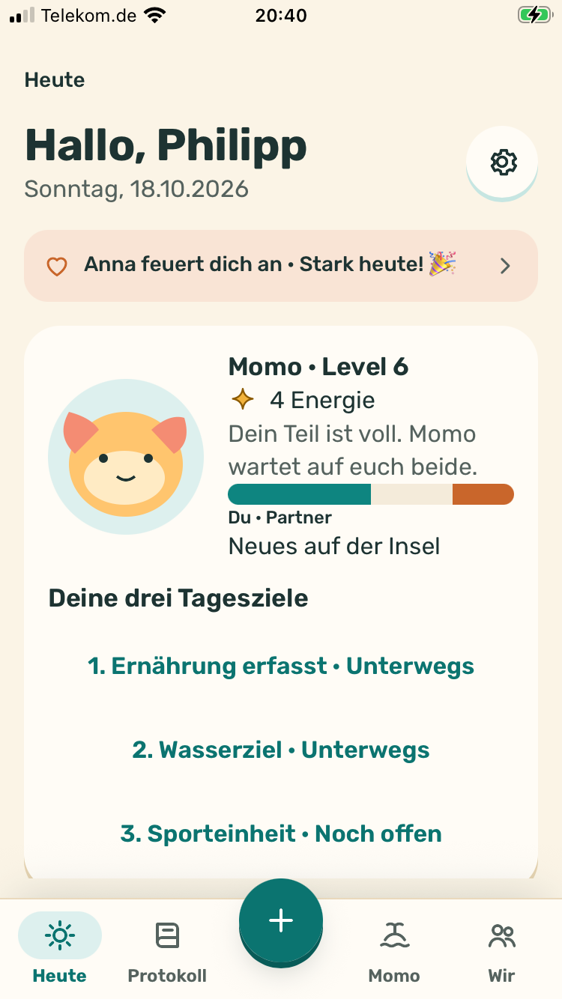
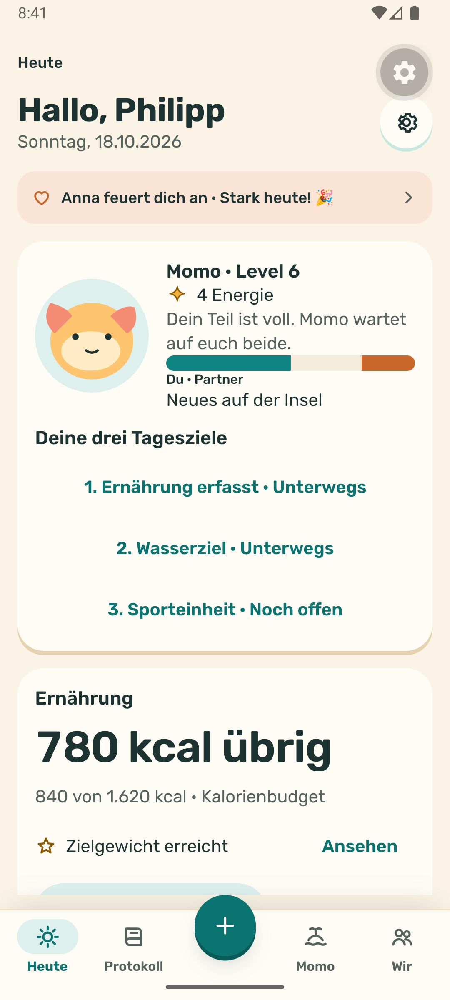
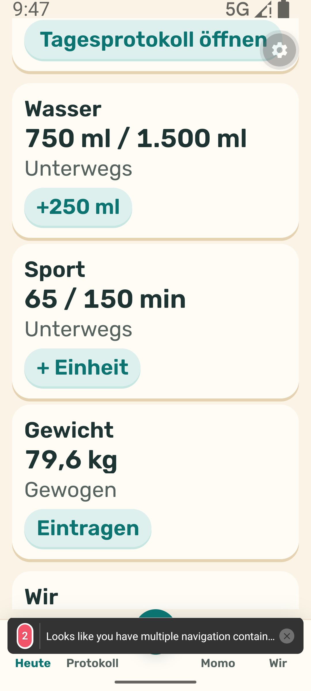

# Native Heute-Prüfung · #109

18.10.2026 · iPhone SE (3. Generation, **physisches Gerät**) und Android-Emulator `medium_phone` (1080 × 2400, 420 dpi; **kein Fairphone 6**). Bilder wurden nativ mit `xcrun devicectl device capture screenshot` bzw. `adb exec-out screencap` aufgenommen, nicht im Browser. Die vollständig ausgefüllte Ansicht nutzt **synthetische Development-Fixtures**, keine echten Gesundheitsdaten. Für den iPhone-Capture wurde die Vorschau nur temporär als Startansicht aktiviert und anschließend vor dem Commit wieder auf „Beispieldaten anzeigen“ zurückgesetzt.

## Kritik: Hauptaufgabe

Die erste Gerätefassung verdrängte das dritte Ziel unter die Tab-Leiste (**P1**). Nach Kompaktierung des Tabtitels, der Anfeuerung, der Zielbuttons und Verlagerung des aktiven Development-Vorschau-Schalters zeigt das iPhone SE **Momo und alle drei Ziele** auf einen Blick. Die Beispielziele zeigen unterschiedliche Bereiche statt dreimal Wasser.

Impeccable-Heuristik-Review, nach Korrektur: **28/40**, P0/P1 = 0 im geprüften Umfang. P2 zum unspezifischen Fehlerzustand wurde danach im Code durch Slotnamen und Versuchshinweis behoben. P3 bleibt die absichtlich einfache Momo-Platzhalterform; endgültige Zeichnung und Accessoires gehören zu Spezifikation 4.

## Nativer Audit

Score **15/20**: Accessibility 3, Performance 3, Erscheinungsbild 3, Plattform 3, Anpassung 3 (jeweils /4). Am Android-Emulator wurden Schriftfaktor 1,3 und 2,0, Scrollen und getrennte Tracker-Aktionen geprüft. Der Accessibility-Tree bei aktiviertem TalkBack enthält ein benanntes Momo-Bild, einen beschriebenen Levelbalken, die Zielbuttons und die Tracker-Aktionen; der TalkBack-Fokus wurde auf dem Bildschirm sichtbar. Die Wasser-Direktaktion misst bei Faktor 2,0 in der nativen UI-Hierarchie etwa 143 × 50 dp; damit ist die 48-dp-Mindesthöhe erfüllt. Schriftfaktor und TalkBack wurden nach der Prüfung auf ihre Ausgangswerte zurückgesetzt. Der dunkle Balken am unteren Rand des 2,0-Bilds ist ein **Expo-Development-Toast**, kein Teil der App.

Auf dem iPhone konnte VoiceOver aktiviert und danach deaktiviert werden. Beim ersten Einschalten überlagerte jedoch der iOS-Systemdialog zur VoiceOver-Einführung die App. Eine **auditive VoiceOver-Traversierung der Oberfläche**, eine **iPhone-Geräteprüfung bei Schriftfaktor 2,0** und echte iPhone-Gesten sind **nicht belegt**. Die Android-Prüfung ersetzt auch keinen Fairphone-6-Gerätelauf. Diese offenen Nachweise nicht als bestanden interpretieren; Komponententests decken Benennung, 48-dp-Flächen und Umbruchlogik zusätzlich ab.
