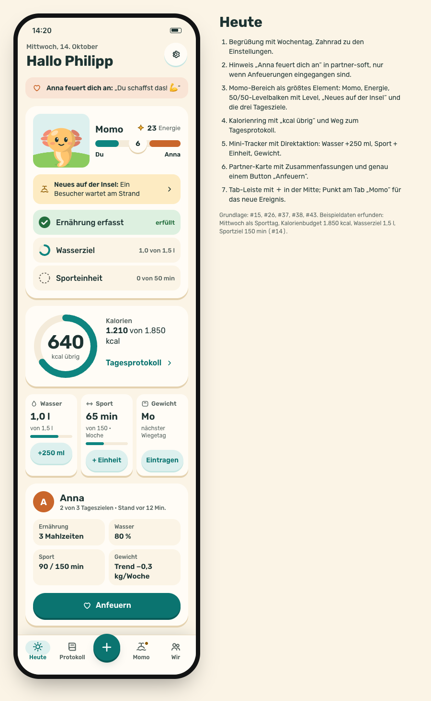
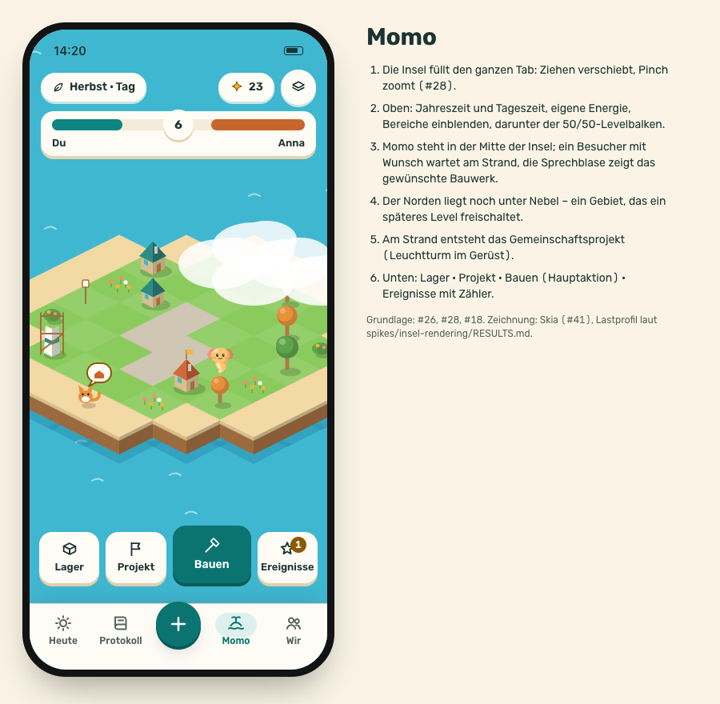
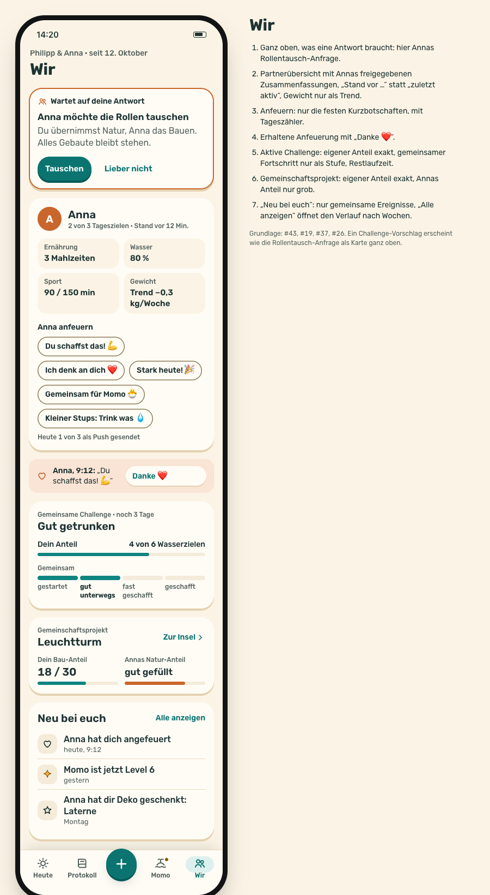

# Prüfung: Design-System „Lagune“ und Kernabläufe mit Impeccable

Ticket: [#91](https://github.com/Yggras/abnehm-app/issues/91) · Stand: 16.10.2026 · Geprüft wurden die Artifact-Version `1792094930-af8a` des Design-Systems [11] und die Spezifikationen 0–5 in ihrer Fassung vom 16.10.2026 [13]–[18].

Quellen-Nummern in eckigen Klammern [n] verweisen auf die Liste am Ende. Mit *eigene Einschätzung* markierte Stellen sind Urteile dieser Prüfung, keine belegten Fakten. Alle Heuristik-Werte sind Urteile nach dem Bewertungsschlüssel von Impeccable [2]; sie sind nicht gemessen.

## Ergebnis in Kürze

- **Kein P0.** Jede geprüfte Hauptaufgabe ist mit dem spezifizierten Verhalten erledigbar.
- **Fünf P1-Befunde**, die vor `/to-tickets` in die Spezifikationen gehören:
  - **B1** „+250 ml“ liegt auf „Heute“ unterhalb des sichtbaren Bereichs. → Nutzerentscheidung vom 16.10.2026: Direktaktion „+250 ml Wasser“ im ＋-Sheet (Spezifikationen 0 und 3).
  - **B2** Löst ein Tipp mehrere Meldungen aus, gibt es keine Regel. Dadurch kann „Rückgängig“ genau dann verloren gehen, wenn ein Tagesziel erfüllt wird. → entschieden, Ergänzung an Spezifikation 0.
  - **B3** Ein ausgeblendeter Import ist nach 5 Sekunden unwiederbringlich. → Nutzerentscheidung vom 16.10.2026: Liste „Ausgeblendete Einträge“ mit „Wieder einblenden“ auf der Einstellungsseite Health (Spezifikation 3).
  - **B4** Die Referenzentwürfe widersprechen den Spezifikationen an sechs Stellen, unter anderem mit der Kurzbotschaft „Kleiner Stups: Trink was 💧“. → entschieden: Vorrangregel in Spezifikation 0, Hinweis in `research/design-system.md`.
  - **B5** Nirgends wird erklärt, dass Momo nur durch *verbaute* Energie wächst. → entschieden, Ergänzung an Spezifikation 4.
- **Elf P2- und acht P3-Befunde.** Sie stehen nur in dieser Datei. Ausnahme ist B7: Per Nutzerentscheidung vom 16.10.2026 zeigt die Partner-Karte auf „Heute“ keine Zahlen mehr (Spezifikationen 0 und 5).
- **Heuristik-Summen** (je von 40): Heute 26 · Momo 26 · Wir 27 · Schnell eintragen 28 · Onboarding 28 · Anfeuern 29. Die drei Referenzentwürfe liegen damit im Band „Acceptable“ (20–27), die drei Abläufe im Band „Good“ (28–35) [2]. Die Entwürfe schneiden schlechter ab, vor allem weil sie von den Spezifikationen abweichen (B4).
- **Verbleib der Dateien:** `docs/PRODUCT.md` bleibt als Verweisdatei. `DESIGN.md` gibt es nur als nicht maßgebliche Momentaufnahme unter `spikes/impeccable-review/`. `.impeccable/` kommt nicht ins Repo (siehe [Verbleib](#verbleib-von-productmd-designmd-und-impeccable)).

## Werkzeug und Vorgehen

### Installation und Version

| Teil | Stand | Beleg |
| --- | --- | --- |
| npm-Paket `impeccable` | 4.6.0 (`latest`, geändert 15.10.2026) | `npm view impeccable` am 16.10.2026 [9] |
| Skill | `skill-v4.6.0` (Release 15.10.2026) | GitHub-Releases [10]; `SKILL.md` meldet `version: 4.6.0` [7] |
| Engine | `impeccable-engine 0.1.15` | `engine-probe` des Binärprogramms aus dem npm-Paket |
| Telemetrie | aus (`"telemetry": false` in `~/.impeccable/config.json`) | `npx impeccable telemetry status` |
| Installation | Projekt: `.claude/skills/impeccable/`, `.claude/agents/impeccable-*.md`, `.pi/skills/impeccable/` | Ausgabe von `npx impeccable@4.6.0 install` am 16.10.2026 |

**Installationsweg:**

- **Ticket-Vorgabe** war die globale Installation `npx impeccable install --scope=global --no-hooks` [1]. Die Sicherheitsprüfung des Auto-Modus von Claude Code lehnte sie als „Self-Modification“ ab, weil sie in `~/.claude/skills` schreibt.
- **Nutzerentscheidung vom 16.10.2026:** Impeccable wird **ins Projekt** installiert, nicht global. Das ist eine Ausnahme von der Regel für allgemeine Skills in `AGENTS.md`.
- **Befehl:** `npx impeccable@4.6.0 install -y --providers=claude,pi --scope=project --no-hooks`.
  - `claude` schreibt die Claude-Code-Fassung nach `.claude/skills/impeccable/` und vier Sub-Agenten nach `.claude/agents/`.
  - `pi` schreibt die pi-Fassung nach `.pi/skills/impeccable/` [20]. Pi liest projektlokal `.pi/skills/` und `.agents/skills/` [21]. Eine dritte Kopie unter `.agents/skills/` würde pi doppelt laden und entfällt deshalb.
- **Kein Symlink:** Die Fassungen unterscheiden sich in Pfaden und Frontmatter (Vergleich der Ordner `.claude`, `.agents` und `.pi` im Release). Ein Symlink nach der Repo-Konvention würde einer Harness falsche Pfade geben.
- **Engine-Binaries:** Der Installer legt je Harness 16 MB für darwin-arm64 unter `scripts/bin/` ab. Sie sind per `.gitignore` ausgeschlossen, denn fehlt das Binary, lädt der Launcher es mit Prüfsumme nach `~/.impeccable/bin/<version>/` (`scripts/impeccable` im Skill).
- **Für die Prüfung selbst** stammte der Skill-Inhalt aus dem Release-Tag `skill-v4.6.0`; die Installation kam erst danach. Der Kontext-Lader (`impeccable context`) fand `docs/PRODUCT.md`, meldete die Plattform `adaptive` und lud die iOS- und die Android-Referenz.

### Methode

- **Native Plattform:** Auf `adaptive` läuft `critique` als reines Design-Review (Assessment A). Detektor und Browser-Overlay entfallen, weil sie nur Web-Markup lesen. Es gibt keinen Banner „degraded“ und keine getrennten Sub-Agenten [2]. Kopfzeile jeder Prüfung: *Method: design review only (detector not applicable, native platform)*.
- **Modus Operate:** Laut `SKILL.md` gehört der Modus nur in einen Oberflächen-Brief, nicht in `PRODUCT.md` [7]. Er ist deshalb hier festgehalten.
- **Bildquelle:** Die drei Referenzentwürfe aus dem Artifact wurden lokal ausgeliefert und mit headless Chrome gerendert und vermessen (`spikes/impeccable-review/screens/`). Für gebaute Apps verlangt Impeccable Simulator- bzw. Gerätebilder [5][6]. Weil es noch keine App gibt, sind das Bilder von HTML-Entwürfen, keine Gerätebilder.
- **Onboarding ohne Bildschirm:** Für das Onboarding gibt es keinen Lagune-Entwurf. Die Prüfung stützt sich nur auf den Text von Spezifikation 1 bzw. 5 (Kennzeichnung in Prüfung 5). Die Prototypen unter `prototypes/` sind älter als „Lagune“ und dienten nur als Beleg für Abläufe.
- **Maßstab:** „Decisions so far“ und „Out of scope“ der [Karte](https://github.com/Yggras/abnehm-app/issues/1), `CONTEXT.md` und die sieben Gestaltungsprinzipien [12]. Befunde, die einer Kartenentscheidung widersprechen, gehen als Frage an den Nutzer.
- **Snapshots** unter `.impeccable/critique/` wurden nicht geschrieben. Sie wären eine zweite Kopie dieser Datei (siehe Verbleib).
- **Stufen** P0–P3 nach Impeccable [2]: P0 verhindert die Aufgabe, P1 macht sie deutlich schwerer oder verwirrend, P2 stört mit Ausweg, P3 ist Feinschliff.

### Personas

Die App hat genau zwei bekannte Nutzer (`docs/PRODUCT.md`). Deshalb gelten diese projektspezifischen Personas:

- **Philipp** – iPhone SE (3. Generation), Fitbit Sense 2 über Google Health → Apple Health, Entwickler und Tester; kennt alle Regeln aus der Planung.
- **Partnerin** – Fairphone 6 mit Android 16 und Fitbit über Health Connect [19]. In Entwürfen heißt sie „Anna“ (Platzhalter). *Annahme:* Sie kennt die Regeln nicht aus der Planung, weil Philipp die Planung steuert ([Karte](https://github.com/Yggras/abnehm-app/issues/1)).

Generische Impeccable-Personas [2] wurden nur übernommen, wo sie einen echten Fehler zeigen: *Casey* (unterwegs, einhändig) beim Eintragen, *Jordan* (zum ersten Mal) beim Onboarding und *Sam* (Bedienungshilfen) bei großer Schrift.

### Bewusste Abweichungen von den Plattform-Referenzen (keine Befunde)

Die iOS- und Android-Referenzen von Impeccable empfehlen Systemschrift, Systemsymbole, Systemfarben, Dunkelmodus und reine Plattform-Navigation [5][6]. „Lagune“ hat sich dagegen entschieden: „Alles Gebrandete ist auf beiden Plattformen gleich, alles Systemnahe folgt der Plattform“ [12]. Impeccable selbst sagt: „The brief wins“ [7]. Diese Punkte sind deshalb keine Befunde:

| Impeccable-Referenz | Lagune | Entscheidung |
| --- | --- | --- |
| SF Pro / Roboto, Systemtextstile [5][6] | Rubik auf beiden Plattformen, skaliert mit der Systemschrift | [#65](https://github.com/Yggras/abnehm-app/issues/65) |
| SF Symbols / Material Symbols [5][6] | eigener Linien-Icon-Satz | [#65](https://github.com/Yggras/abnehm-app/issues/65) |
| Dunkelmodus als gleichwertiges Erscheinungsbild [5][6] | nur hell in V1 | Karte, „Out of scope“ |
| Tab-Leiste nur für Bereiche, nie für Aktionen [5] | ＋ als mittlerer Tab-Platz öffnet die Erfassung | [#15](https://github.com/Yggras/abnehm-app/issues/15) |
| Material-Komponenten und Tonal Elevation [6] | gebrandete Komponenten mit Sockelkante; nativ nur Sheet, Schalter, Picker, Menüs | [#41](https://github.com/Yggras/abnehm-app/issues/41), [#65](https://github.com/Yggras/abnehm-app/issues/65) |

Die Plattformgarantien gelten trotzdem und sind spezifiziert: sichere Bereiche, Wischen-zurück auf iOS, System-Zurück auf Android und „Bewegung reduzieren“ (Spezifikation 0, Abschnitte 6 und 7 [13]). Eine Lücke dazu steht in B11.

## Befunde im Überblick

| ID | Stufe | Befund | Quelle | Verbleib |
| --- | --- | --- | --- | --- |
| B1 | P1 | „+250 ml“ erst nach Scrollen erreichbar | Entwurf Heute; Spez. 0 §6, Spez. 3 §4 | Nutzerentscheidung → Spez. 0, Spez. 3 |
| B2 | P1 | Mehrere Meldungen zu einem Tipp ohne Regel; „Rückgängig“ kann verloren gehen | Spez. 0 §6, Spez. 4 §6, Spez. 3 §4 | entschieden → Spez. 0 |
| B3 | P1 | Ausgeblendeter Import nach 5 s endgültig weg | Spez. 3 §4, „Out of Scope“ | Nutzerentscheidung → Spez. 3 |
| B4 | P1 | Referenzentwürfe widersprechen den Spezifikationen | Entwürfe Heute/Wir, Mini-Tracker-README; Spez. 0 §5, Spez. 4 §12, Spez. 5 §2–4 | entschieden → Spez. 0, `research/design-system.md` |
| B5 | P1 | Spielschleife „Tagesziel → Energie → Bauen → Momo wächst“ wird nirgends erklärt | Spez. 1 §9, Spez. 4 §6–7 | entschieden → Spez. 4 |
| B6 | P2 | Zwei Sportzahlen verschiedener Bedeutung und doppelte Wasseranzeige auf „Heute“ | Entwurf Heute | nur hier |
| B7 | P2 | Partnerwerte auf „Heute“ in gleicher Form direkt unter den eigenen | Entwurf Heute; Spez. 5 §3 | Nutzerentscheidung → Spez. 0, Spez. 5 |
| B8 | P2 | ＋ → „Essen“ verlangt bei jedem Eintrag die Wahl der Mahlzeit | Spez. 2 §6 | nur hier |
| B9 | P2 | Nach dem Speichern eines Essens über ＋ landet man im Protokoll statt am Ausgangsort | Spez. 2 §6, Spez. 0 §6 | nur hier |
| B10 | P2 | Bauen ohne „Rückgängig“; Korrektur nur über „Umstellen“ | Spez. 4 §7 | nur hier |
| B11 | P2 | System-Zurück im Bau-Modus nicht festgelegt | Spez. 4 §7 | nur hier |
| B12 | P2 | Leiste und HUD des Tabs „Momo“ bei Schriftfaktor 2,0 nicht geregelt | Entwurf Momo; Spez. 0 §7 | nur hier |
| B13 | P2 | Wochenplan-Schritt überfrachtet, Vorauswahl der Sporttage fehlt | Spez. 1 §9 | nur hier |
| B14 | P2 | Eingeladene Person: „Partner einladen“ und „Code eingeben“ gleichrangig, Einfügen des Codes nicht geregelt | Spez. 5 §5 | nur hier |
| B15 | P2 | „Danke“ nur am selben lokalen Tag möglich | Spez. 5 §3–4 | nur hier |
| B16 | P2 | Onboarding: lange Datenstrecke ohne Momo | Spez. 1 §9 | nur hier |
| B17 | P3 | Onboarding-Rahmen bei Schriftfaktor 2,0 ohne Entwurf nicht prüfbar | Spez. 1 §9 | Prüfpunkt für natives `audit` |
| B18 | P3 | Gleich aussehende Mini-Tracker-Buttons mit verschiedenem Verhalten | Entwurf Heute; Spez. 3 §4 | nur hier |
| B19 | P3 | „Herbst · Tag“ sieht aus wie ein Button | Entwurf Momo | nur hier |
| B20 | P3 | Anfeuern lässt sich nicht zurücknehmen | Spez. 5 §4 | nur hier |
| B21 | P3 | Mehrere Primär-Buttons auf „Wir“ | Entwurf Wir; Button-Regel [12] | nur hier |
| B22 | P3 | Schnelles Mehrfachtippen: nur die letzte Wasserbuchung per Meldung umkehrbar | Spez. 0 §6, Spez. 3 §4 | nur hier |
| B23 | P3 | `research/design-system.md` nannte 60 Farben, `tokens.json` enthält 61 | `document` | dort korrigiert |
| B24 | P3 | Federn stehen nur in `code/tokens.ts`, nicht in `tokens.json` | `document` | nur hier |

## Prüfung 1: Referenzentwurf „Heute“

*Method: design review only (detector not applicable, native platform)* · Hauptaufgabe: **250 ml Wasser mit einem Tipp eintragen und bei Bedarf rückgängig machen.** Grundlage: Vorschau `BildschirmHeute` [11], Spezifikation 0 §6 [13], Spezifikation 3 §4–5 [16].

| # | Heuristik | Wert | Wichtigster Punkt |
| --- | --- | --- | --- |
| 1 | Sichtbarkeit des Systemzustands | 3 | Fortschritt überall sichtbar; offen, welche Meldung nach einem zielerfüllenden Tipp erscheint (B2) |
| 2 | Bezug zur realen Welt | 3 | Deutsch, Einheiten mit Leerzeichen; zwei Sportzahlen mit verschiedener Bedeutung (B6) |
| 3 | Kontrolle und Freiheit | 3 | „Rückgängig“ statt Dialog, kann aber bei mehreren Meldungen verloren gehen (B2) |
| 4 | Konsistenz und Standards | 2 | gleich aussehende Buttons mit verschiedenem Verhalten (B18); Entwurf weicht von den Spezifikationen ab (B4) |
| 5 | Fehlervermeidung | 3 | 48-dp-Flächen, kein Bestätigungsdialog nötig |
| 6 | Wiedererkennen statt Erinnern | 3 | Icons immer mit Text, Tab-Beschriftungen |
| 7 | Flexibilität und Effizienz | 2 | Direktaktion erst nach Scrollen (B1); ＋ → „Wasser“ führt nur zum Detailbildschirm |
| 8 | Ästhetik und Minimalismus | 2 | sechs Abschnitte, Wasserstand doppelt, Momo-Bereich mit acht Elementen |
| 9 | Fehler erkennen und beheben | 3 | Offline heißt „veraltet“ mit Zeitstempel, nie Problem-Rot |
| 10 | Hilfe und Dokumentation | 2 | Energie, Level und Tagesziele werden nirgends erklärt (B5) |
| | **Summe** | **26/40** | **Acceptable** |

**Design-Spezifität.** Der Entwurf ist klar für dieses Produkt gemacht und nicht austauschbar. Sand, Sockelkante, Momo mit Levelbalken in zwei Personenfarben und die neutralen Zustände ohne Rot ergeben eine eigene Welt. Die Bedienelemente bleiben trotzdem gewöhnliche Karten, Buttons und Tabs (*eigene Einschätzung*).

**Gesamteindruck.** Die Hierarchie folgt „Momo zuerst“, und die Tonalität trifft „wohlwollend statt wertend“. Die größte Chance: Die häufigste Handlung des Tages, „+250 ml“, liegt unterhalb des sichtbaren Bereichs.

**Was funktioniert**

- **Neutrale Zustände:** „Sporteinheit · 0 von 50 min“ mit gestricheltem Kreis statt Rot (Prinzip 2). Bei offenen Zielen entsteht kein Schamgefühl.
- **Ein Tipp plus „Rückgängig“:** Das entfernt die häufigste Reibung beim Erfassen (Prinzip 5).
- **„Stand vor 12 Min.“ beim Partner:** Das zeigt die Aktualität, ohne die App-Nutzung des Partners zu verraten.

**Priority Issues**

- **[P1] B1 „+250 ml“ ist nicht ohne Scrollen erreichbar.**
  - *Messung:* Im eigenen Rahmen des Design-Systems (Bildschirm 800 pt hoch, Tab-Leiste ab 718 pt; gemessen am Entwurf „Momo“) liegt der Button bei 885–929 pt unter der Oberkante, also 167–211 pt unterhalb des sichtbaren Bereichs. Der Kalorienring beginnt bei etwa 600 pt.
  - *Kleinere Geräte:* Das iPhone SE (3. Generation) ist mit 375 × 667 pt kleiner. Der Wert ist hier nicht aus einer Primärquelle belegt, weil Apples Gerätetabelle in dieser Sitzung nicht abrufbar war. Die Höhe des Fairphone 6 in dp ist nicht belegt.
  - *Warum das zählt:* „Ein Tipp genügt“ wird zu „scrollen und tippen“. Der Weg über ＋ braucht drei Tipps (＋ → Wasser → Glas 250 ml), weil „Wasser“ im ＋-Sheet den Detailbildschirm öffnet (Spezifikation 3 §4). Wasser ist die häufigste Eingabe des Tages.
  - *Behebung:* Die Reihenfolge der Slots legt Spezifikation 0 nach [#15](https://github.com/Yggras/abnehm-app/issues/15) fest, also ist das eine Produktfrage. Empfehlung: Das ＋-Sheet bekommt eine Direktaktion „+250 ml Wasser“, die wie der Mini-Tracker bucht (zwei Tipps von jedem Tab). Die Reihenfolge von „Heute“ bleibt. **Nutzerentscheidung vom 16.10.2026: Empfehlung übernommen.**
  - *Befehl:* `/impeccable layout`.
- **[P1] B2 Mehrere Meldungen zu einem Tipp.**
  - *Was passiert:* Erreicht der vierte Tipp auf „+250 ml“ das Wasserziel von 1,5 l, entstehen gleichzeitig „+250 ml Wasser · Rückgängig“ (Spezifikation 3 §4) und „Wasserziel erfüllt · +1 Energie“ (Spezifikation 4 §6). War es das dritte Tagesziel, kommt „Alle drei geschafft · +1 Energie“ dazu, bei Levelaufstieg auch „Momo ist jetzt auf Level N“.
  - *Was fehlt:* Spezifikation 0 §6 kennt einen Meldungs-Host mit genau einer Meldung, aber keine Regel für Reihenfolge, Ersetzen oder Zusammenführen.
  - *Warum das zählt:* Ersetzt die Erfolgsmeldung die Buchungsmeldung, fehlt „Rückgängig“ genau nach dem Tipp, der am ehesten ein Versehen ist. Werden alle Meldungen nacheinander gezeigt, stehen sie 15–20 Sekunden.
  - *Behebung (entschieden):* siehe [Ergänzungen](#ergänzungen-an-den-spezifikationen).
  - *Befehl:* `/impeccable harden`.
- **[P1] B4 Der Entwurf weicht von den Spezifikationen ab:** „2 von 3 Tageszielen“, Partnerkacheln, Mini-Tracker-README. Die Einzelheiten stehen bei Prüfung 3. *Befehl:* `/impeccable document`.
- **[P2] B6 Zwei Sportzahlen und doppelte Wasseranzeige.**
  - *Was passiert:* „Sporteinheit · 0 von 50 min“ meint eine einzelne Einheit heute, „65 min von 150 · Woche“ die Woche. Beide stehen auf einem Bildschirm, und „Wasserziel · 1,0 von 1,5 l“ steht zweimal da.
  - *Warum das zählt:* Wer die Regel nicht kennt, liest „0 Minuten, obwohl ich 65 habe“.
  - *Behebung:* Texte schärfen: „Sporteinheit heute · 0 von 50 min“ und „65 von 150 min diese Woche“.
  - *Befehl:* `/impeccable clarify`.
- **[P2] B7 Partnerwerte unter den eigenen.**
  - *Was passiert:* Die Partner-Karte zeigt „Sport 45 von 150 min diese Woche“ (Spezifikation 5 §2–3) etwa 100 pt unter dem eigenen „65 von 150 min“, in derselben Einheit mit demselben Ziel.
  - *Warum das zählt:* „Nie direkt neben eigenen Werten“ (Spezifikation 5, User Story 91) ist formal erfüllt. Prinzip 3 („Miteinander, nie gegeneinander“) wird auf dem täglichen Hauptbildschirm aber praktisch unterlaufen (*eigene Einschätzung*).
  - *Behebung:* Die Partner-Karte auf „Heute“ zeigt nur Name, groben Tageszielstand und „Anfeuern“. Zahlen gibt es nur in „Wir“. Das berührt [#15](https://github.com/Yggras/abnehm-app/issues/15) und [#43](https://github.com/Yggras/abnehm-app/issues/43) und ist damit eine Produktfrage. **Nutzerentscheidung vom 16.10.2026: Empfehlung übernommen.**
  - *Befehl:* `/impeccable distill`.

**Persona Red Flags**

- **Philipp (iPhone SE, Casey-Lage):** Unterwegs mit einer Hand muss er für Wasser scrollen oder drei Tipps über ＋ machen (B1). Der vierte Tipp, der das Wasserziel erfüllt, kann die Buchungsmeldung samt „Rückgängig“ verdrängen (B2).
- **Partnerin (Fairphone 6, erstmals):** Sie liest „Sporteinheit · 0 von 50 min“ neben „65 min von 150 · Woche“ als Widerspruch (B6). Energie und Level werden ihr nirgends erklärt (B5).

**Minor Observations**

- „+ Einheit“ und „Eintragen“ sehen aus wie „+250 ml“, öffnen aber Formulare (B18).
- Der Hinweis „Anna feuert dich an“ schiebt den Momo-Bereich um eine Zeile nach unten und vergrößert B1, bis „Danke“ gesagt ist oder der Tag wechselt.

**Questions to Consider**

- Muss der Momo-Bereich drei Tageszielzeilen *und* den Inselhinweis tragen, oder reicht eine kompakte Reihe mit drei Symbolen, die beim Antippen aufklappt?
- Was wäre, wenn „+250 ml“ auch dort säße, wo der Daumen ohnehin ist: im ＋-Sheet?

## Prüfung 2: Referenzentwurf „Momo“

*Method: design review only (detector not applicable, native platform)* · Hauptaufgabe: **mit vorhandener Energie einen Bauplan auf der Insel bauen.** Grundlage: Vorschau `BildschirmMomo` [11], Spezifikation 4 §6–7 [17].

| # | Heuristik | Wert | Wichtigster Punkt |
| --- | --- | --- | --- |
| 1 | Sichtbarkeit des Systemzustands | 3 | Energie, Level, Ereigniszähler, leuchtende Felder im Bau-Modus |
| 2 | Bezug zur realen Welt | 3 | Lager, Projekt, Bauen, Ereignisse als vertraute Spielbegriffe |
| 3 | Kontrolle und Freiheit | 2 | Abbrechen geht jederzeit, Bauen selbst ist endgültig (B10); System-Zurück offen (B11) |
| 4 | Konsistenz und Standards | 3 | gleiche Sockelkante wie auf „Heute“; „Herbst · Tag“ wirkt wie ein Button (B19) |
| 5 | Fehlervermeidung | 2 | ein Tipp auf ein leuchtendes Feld gibt Energie endgültig aus, auf einer Fläche mit Zieh- und Zoomgesten |
| 6 | Wiedererkennen statt Erinnern | 3 | Leiste mit Icon und Text, Preise im Bauplan-Sheet |
| 7 | Flexibilität und Effizienz | 3 | Bauen über die Leiste oder direkt über ein freies Feld |
| 8 | Ästhetik und Minimalismus | 3 | Insel füllt den Bildschirm, wenige Bedienelemente an den Rändern |
| 9 | Fehler erkennen und beheben | 2 | „Noch ‹n› Energie“ ist gut; nach einem Fehlbau gibt es nur „Umstellen“ |
| 10 | Hilfe und Dokumentation | 2 | keine Erklärung, wie Energie Momo wachsen lässt (B5) |
| | **Summe** | **26/40** | **Acceptable** |

**Design-Spezifität.** Hoch. Das isometrische Diorama mit Sockelkante, Licht von links oben und denselben Farben wie die Oberfläche ist das Erkennungszeichen der App (*eigene Einschätzung*).

**Gesamteindruck.** Die Hauptaktion „Bauen“ sitzt im Daumenbereich und ist hervorgehoben. Die größte Lücke ist nicht visuell: Niemand erfährt, dass erst verbaute Energie Momo wachsen lässt.

**Was funktioniert**

- **„Bauen“ als einzige Primäraktion** unten in der Mitte, mit Icon und Text.
- **Ereignisse mit Zähler** und derselbe Punkt am Tab: eine Sprache für „Neues“.
- **Kein Druck:** Ereignisse verfallen nie, „Noch ‹n› Energie“ ist neutral (Spezifikation 4 §7, §9).

**Priority Issues**

- **[P1] B5 Die Spielschleife wird nicht erklärt.**
  - *Was gilt:* Tagesziele bringen nur Energie. Momo levelt erst durch selbst verbaute Energie, je Person zur Hälfte ([#28](https://github.com/Yggras/abnehm-app/issues/28), Spezifikation 4 §3).
  - *Was fehlt:* Weder Onboarding (Spezifikation 1 §9) noch Tab „Momo“ (Spezifikation 4 §7) noch „Heute“ erklären das. Eine Suche nach „Einführung“, „erklär…“, „Hilfe“ und „Tutorial“ in den Spezifikationen 0, 1 und 4 fand nur Erklärungen zu Geschlecht, Wiegetag, Haltemodus und Challenge-Vorlagen.
  - *Warum das zählt:* Wer nicht baut, füllt seine Hälfte nicht. Der Partner sieht dann „Deine Hälfte ist voll – Momo wartet auf ‹Name›“ (Spezifikation 4 §7), und das gemeinsame Spiel steht still, ohne dass jemand weiß, warum.
  - *Behebung (entschieden):* siehe [Ergänzungen](#ergänzungen-an-den-spezifikationen).
  - *Befehl:* `/impeccable onboard`.
- **[P2] B10 Bauen ohne „Rückgängig“.**
  - *Was gilt:* „Ein Tippen baut“; Abreißen und Erstattung gibt es nicht (Spezifikation 4 §7, [#35](https://github.com/Yggras/abnehm-app/issues/35)). Ein Fehlbau auf dem falschen Feld lässt sich nur über „Objekt antippen → Umstellen“ korrigieren.
  - *Behebung:* Die Bau-Meldung bietet direkt „Umstellen“ an („Laterne gebaut · Umstellen“). Es gibt keine Erstattung, also keinen Widerspruch zu #35.
  - *Befehl:* `/impeccable harden`.
- **[P2] B11 System-Zurück im Bau-Modus.**
  - *Was fehlt:* Spezifikation 4 §7 sagt „Abbrechen geht jederzeit“, legt aber nicht fest, was die Android-Zurück-Geste im Bau-Modus tut. Impeccable verlangt: „System Back always works … never trap the user“ [6].
  - *Behebung:* Zurück beendet zuerst den Bau-Modus, dann ein offenes Sheet, erst danach greift die normale Navigation.
  - *Befehl:* `/impeccable adapt`.
- **[P2] B12 Große Schrift im Tab „Momo“.**
  - *Was fehlt:* Spezifikation 0 §7 regelt Umbrüche ab Faktor 1,3 nur für Momo-Bereich, Mini-Tracker und Partner-Zusammenfassungen auf „Heute“. Vier beschriftete Buttons nebeneinander (je etwa 75–100 pt breit im Entwurf) und das HUD sind für Faktor 2,0 nicht geregelt.
  - *Behebung:* Beschriftungen der Leiste wie `tab-label` auf 1,3 begrenzen (Icon trägt die Bedeutung mit). Das HUD bricht ab 1,3 in zwei Zeilen um.
  - *Befehl:* `/impeccable adapt`.

**Persona Red Flags**

- **Partnerin (erstmals):** Sie sammelt Energie, ohne zu bauen, weil sie annimmt, dass Tagesziele Momo direkt wachsen lassen (B5). Auf dem Fairphone kann ein Zurückwischen im Bau-Modus den Tab verlassen statt abzubrechen (B11).
- **Sam (große Schrift):** „Ereignisse“ bei Faktor 2,0 passt nicht in ein Viertel der Breite (B12).

**Minor Observations**

- „Herbst · Tag“ trägt Pille und Sockelkante wie ein Button, ist aber nur Anzeige (B19).

**Questions to Consider**

- Was wäre, wenn die Energie auf „Heute“ antippbar wäre und direkt in den Bau-Modus führte?

## Prüfung 3: Referenzentwurf „Wir“

*Method: design review only (detector not applicable, native platform)* · Hauptaufgabe: **die Partnerin anfeuern und eine erhaltene Anfeuerung mit „Danke“ beantworten.** Grundlage: Vorschau `BildschirmWir` [11], Spezifikation 5 §2–4 [18], Spezifikation 4 §12 [17].

| # | Heuristik | Wert | Wichtigster Punkt |
| --- | --- | --- | --- |
| 1 | Sichtbarkeit des Systemzustands | 3 | „Stand vor …“, Push-Zähler, Challenge-Stufe |
| 2 | Bezug zur realen Welt | 3 | warme, kurze Sprache; Gewicht nur als Trend |
| 3 | Kontrolle und Freiheit | 3 | „Lieber nicht“ gleichwertig neben „Tauschen“; Anfeuern ohne Zurücknehmen (B20) |
| 4 | Konsistenz und Standards | 1 | Entwurf widerspricht an mehreren Stellen den Spezifikationen (B4); mehrere Primär-Buttons (B21) |
| 5 | Fehlervermeidung | 3 | nur feste, freundliche Botschaften |
| 6 | Wiedererkennen statt Erinnern | 3 | antwortbedürftige Karte ganz oben |
| 7 | Flexibilität und Effizienz | 3 | Anfeuern mit zwei Tipps; Pull-to-Refresh |
| 8 | Ästhetik und Minimalismus | 3 | klare Reihenfolge; lange Seite, „Neu bei euch“ erst bei etwa 1.270 pt |
| 9 | Fehler erkennen und beheben | 3 | Offline als „letzter Stand“, nicht als Fehler |
| 10 | Hilfe und Dokumentation | 2 | Freigaben werden in den Einstellungen erklärt, auf „Wir“ nicht |
| | **Summe** | **27/40** | **Acceptable** |

**Design-Spezifität.** Die Personenfarbe Sonne, der Rahmen in `partner` für antwortbedürftige Karten und die Stufen statt Partnerzahlen sind eigenständig und passen zu Prinzip 3 (*eigene Einschätzung*).

**Gesamteindruck.** Die Gliederung nach [#43](https://github.com/Yggras/abnehm-app/issues/43) trägt gut. Der Entwurf zeigt aber Inhalte, die die Spezifikationen inzwischen ausschließen. Wer ihn als Vorlage nimmt, baut das Falsche.

**Priority Issues**

- **[P1] B4 Abweichungen zwischen Entwürfen und Spezifikationen.**

  | Stelle im Entwurf | Spezifikation | Folge, wenn man dem Entwurf folgt |
  | --- | --- | --- |
  | „Wir“: fünf Kurzbotschaften als Chips direkt auf der Seite, darunter **„Kleiner Stups: Trink was 💧“** | Spezifikation 5 §4: Primäraktion „Anfeuern“ öffnet ein Sheet; Katalog ohne diese Botschaft; „kein Bezug auf ein offenes Ziel“; „Stupsen“ ist gestrichen ([#37](https://github.com/Yggras/abnehm-app/issues/37)) | Druckbotschaft mit gestrichenem Begriff im Produkt |
  | „Heute“ und „Wir“: „2 von 3 Tageszielen“ | Spezifikation 0 §5, Spezifikation 5 §2: nur grober Stand („fast geschafft“), „X von 3“ entfällt | exakter Partnerwert gegen [#43](https://github.com/Yggras/abnehm-app/issues/43) |
  | Gewicht „Trend −0,3 kg/Woche“ | Spezifikation 0 §5, Spezifikation 5 §2: „Trend −0,4 kg in 2 Wochen“ | andere Kennzahl als Projektion und Detailbildschirm |
  | „Annas Natur-Anteil · gut gefüllt“ mit Balken | Spezifikation 0 §2, Spezifikation 4 §12: `community_project` enthält nur eigenen Stand und gemeinsame Stufe | Anzeige ohne Datenquelle, Partneranteil sichtbar |
  | Partner-Karte auf „Heute“ als 2 × 2-Kacheln mit Zusammenfassungen | Spezifikation 5 §3 (seit B7): nur Name, grober Tageszielstand und „Anfeuern“ | Partnerwerte unter den eigenen, verschärft B1 |
  | Mini-Tracker-README: „der Button bucht sofort“ [12] | Spezifikation 3 §4: nur Wasser bucht, Sport und Gewicht öffnen Formulare | widersprüchliche Vorgabe |

  - *Warum das zählt:* Spezifikation 0 §7 erklärt `research/design-system.md` für verbindlich, und dort sind die Referenzentwürfe beschrieben. Es fehlt eine Regel, was bei Widersprüchen gilt.
  - *Behebung (entschieden):* siehe [Ergänzungen](#ergänzungen-an-den-spezifikationen).
  - *Befehl:* `/impeccable document`.
- **[P2] B15 „Danke“ nur am selben Tag.**
  - *Was gilt:* „Danke“ gilt für die unbedankten Anfeuerungen des aktuellen lokalen Tags, und der Hinweis auf „Heute“ verschwindet mit dem Tageswechsel (Spezifikation 5 §3–4).
  - *Warum das zählt:* Eine Anfeuerung um 23:50 kann am Morgen nicht mehr bedankt werden. Damit bricht die Rückmeldeschleife genau bei abendlicher Ermutigung.
  - *Behebung:* Bedankbar bleiben die unbedankten Anfeuerungen der letzten 24 Stunden.
  - *Befehl:* `/impeccable harden`.

**Persona Red Flags**

- **Partnerin:** Ein Implementierer, der dem Entwurf folgt, zeigt ihr Philipps exakten Projektanteil und eine Botschaft, die an ihr Trinkziel erinnert (B4). Beides widerspricht dem, was sie laut [#43](https://github.com/Yggras/abnehm-app/issues/43) und [#37](https://github.com/Yggras/abnehm-app/issues/37) erwarten darf.

**Minor Observations**

- „Tauschen“ in der antwortbedürftigen Karte und „Anfeuern“ sind beide Primär-Buttons. Laut Button-Regel gibt es höchstens eine Primäraktion je Bildschirm [12] (B21). Vorschlag: In antwortbedürftigen Karten ist die Zusage ein Sekundär-Button.

## Prüfung 4: Kernablauf „Schnell eintragen“

*Method: design review only (detector not applicable, native platform)* · Hauptaufgabe: **über den Tag Wasser, eine Mahlzeit und ein Training eintragen und einen Fehler korrigieren.** Grundlage: Spezifikation 0 §6 [13], Spezifikation 2 §4–7 [15], Spezifikation 3 §3–5 [16], Entwurf „Heute“.

| # | Heuristik | Wert | Wichtigster Punkt |
| --- | --- | --- | --- |
| 1 | Sichtbarkeit des Systemzustands | 3 | jede Buchung mit Meldung; Regel für mehrere Meldungen fehlt (B2) |
| 2 | Bezug zur realen Welt | 3 | Glas/Flasche, Schnellwahl 15/30/45/60 min, „Tippfehler?“ |
| 3 | Kontrolle und Freiheit | 2 | überall „Rückgängig“, aber Ausblenden nach 5 s endgültig (B3) |
| 4 | Konsistenz und Standards | 2 | Rückkehrziel nach dem Speichern uneinheitlich (B9); Mini-Tracker-Buttons (B18) |
| 5 | Fehlervermeidung | 3 | Plausibilitätsfrage bei > 2 kg, gültige Wertebereiche, Barcode pausiert nach Treffer |
| 6 | Wiedererkennen statt Erinnern | 3 | Favoriten, „Zuletzt verwendet“, letzte Menge und Dauer vorausgefüllt |
| 7 | Flexibilität und Effizienz | 3 | Favoriten und Mahlzeitenfavoriten; Pflichtwahl der Mahlzeit über ＋ (B8) |
| 8 | Ästhetik und Minimalismus | 3 | Hinzufügen-Bildschirm mit höchstens fünf Einträgen je Liste |
| 9 | Fehler erkennen und beheben | 3 | Barcode-Fehler mit manuellem Weg, KI-Fehler mit Lösungsweg |
| 10 | Hilfe und Dokumentation | 3 | „KI-Schätzung – bitte Mengen prüfen“, „wird nur angezeigt“ bei Sportkalorien |
| | **Summe** | **28/40** | **Good** |

**Gesamteindruck.** Der Ablauf ist durchdacht: keine Dialoge, überall vorausgefüllte Werte, offline voll nutzbar. Schwach sind die Ränder: was nach mehreren Meldungen, nach dem Ausblenden und nach dem Speichern passiert.

**Was funktioniert**

- **Vorausfüllen** von letzter Menge, letzter Dauer und letztem Gewicht. Meist bleibt nur eine Änderung zu tippen.
- **Inline-Plausibilität** („Tippfehler?“ mit „Stimmt so“ / „Korrigieren“) statt Systemdialog.
- **Ehrliches Korrigieren** kostet keine Energie ([#35](https://github.com/Yggras/abnehm-app/issues/35)).

**Priority Issues**

- **[P1] B1** und **[P1] B2** wie in Prüfung 1.
- **[P1] B3 Ein ausgeblendeter Import ist nach 5 Sekunden unwiederbringlich.**
  - *Was gilt:* Ausgeblendete Einträge verschwinden aus allen Listen und Summen und kommen beim nächsten Import nicht wieder. „Zurücknehmen lässt sich das in V1 nur über ‚Rückgängig‘ in der Meldung“ (Spezifikation 3 §4). „Out of Scope“ derselben Spezifikation nennt „Ausblenden ist endgültig“.
  - *Warum das zählt:* Ein versehentlich ausgeblendetes Fitbit-Training ist nach 5 Sekunden für immer aus der Wochensumme verschwunden. Es lässt sich auch in der Quell-App nicht zurückholen. Wer das merkt, hat keinen Weg mehr (Heuristik 3 und 9).
  - *Behebung:* Spezifikation 3 hat das bewusst ausgeschlossen, also ist das eine Produktfrage. Empfehlung: Die Einstellungsseite Health bekommt eine Liste „Ausgeblendete Einträge“ mit „Wieder einblenden“. Technisch ist das dieselbe Operation wie das bestehende Undo (`hidden_at` entfernen); Datenmodell und Sync bleiben unverändert. **Nutzerentscheidung vom 16.10.2026: Empfehlung übernommen.**
  - *Befehl:* `/impeccable harden`.
- **[P2] B8 Wahl der Mahlzeit bei jedem Eintrag über ＋.**
  - *Was gilt:* „Essen“ im ＋-Sheet zeigt zuerst die vier Mahlzeiten (Spezifikation 2 §6).
  - *Behebung:* Die Mahlzeit nach Uhrzeit vorbelegen (Designwert) und im Hinzufügen-Bildschirm als änderbaren Chip zeigen. Der Auswahlschritt entfällt.
  - *Befehl:* `/impeccable distill`.
- **[P2] B9 Rückkehrziel nach dem Speichern.**
  - *Was gilt:* Spezifikation 2 §6: „Speichern schließt das Sheet und kehrt zum Protokoll zurück“. Spezifikation 0 §6 regelt die Rückkehr „zum Aufrufer“ nur für modale Abläufe; `capture.food` ist im Routenkatalog nicht als modal markiert.
  - *Warum das zählt:* Wasser über den Mini-Tracker bleibt auf „Heute“, ein Essen über ＋ endet im Tab „Protokoll“. Momos Reaktion auf das erfüllte Tagesziel „Ernährung erfasst“ passiert dann außer Sicht.
  - *Behebung:* Nach dem Speichern zurück zum Aufrufer: über ＋ zum Ausgangstab, über das „+“ einer Mahlzeit zum Protokoll.
  - *Befehl:* `/impeccable clarify`.

**Persona Red Flags**

- **Philipp (Casey-Lage):** Er blendet im Gehen ein doppeltes Training aus, erwischt das falsche, und die Meldung ist weg, bevor er hinsieht (B3). Für Wasser scrollt er (B1).
- **Partnerin (Fairphone, Health Connect):** Sie trägt Mittagessen über ＋ ein, muss erst „Mittagessen“ wählen (B8) und landet danach im Tab „Protokoll“ statt dort, wo sie angefangen hat (B9).

**Minor Observations**

- Bei schnellem Mehrfachtippen auf „+250 ml“ ist nur die letzte Buchung über die Meldung umkehrbar; frühere über den Detailbildschirm (B22). Das ist akzeptabel.
- „offen · bereits gutgeschrieben“ (Spezifikation 1 §6) ist korrekt, braucht aber eine Probe mit der Partnerin, ob sie es versteht (*eigene Einschätzung*).

## Prüfung 5: Kernablauf „Onboarding“ (nur aus dem Text)

> **Ohne Lagune-Bildschirm:** Für das Onboarding gibt es keinen Referenzentwurf. Diese Prüfung bewertet nur den Ablauf aus Spezifikation 1 §9 und Spezifikation 5 §5 bzw. Spezifikation 3 (Steckplatz 9), nicht das Aussehen.

*Method: design review only (detector not applicable, native platform)* · Hauptaufgabe: **von der Installation bis zu „Heute“, gekoppelt mit dem Partner.** Grundlage: Spezifikation 1 §2–9 [14], Spezifikation 5 §5 [18], Spezifikation 0 §6 [13].

| # | Heuristik | Wert | Wichtigster Punkt |
| --- | --- | --- | --- |
| 1 | Sichtbarkeit des Systemzustands | 3 | „Schritt x von 11“, Fortsetzen nach Abbruch |
| 2 | Bezug zur realen Welt | 3 | verständliche Aktivitätsstufen, erklärtes Berechnungsgeschlecht |
| 3 | Kontrolle und Freiheit | 3 | Zurück, Überspringen 9–11, Entwurf bleibt erhalten |
| 4 | Konsistenz und Standards | 3 | gleicher Rahmen für Pflicht- und Steckplatzschritte |
| 5 | Fehlervermeidung | 3 | BMI-Untergrenze, Budget-Untergrenze, Alter ab 18 |
| 6 | Wiedererkennen statt Erinnern | 2 | Wochenplan setzt den Begriff Tagesziel voraus (B13); Code aus einer anderen App merken (B14) |
| 7 | Flexibilität und Effizienz | 2 | acht Pflichtschritte vor jedem Spielerlebnis (B16) |
| 8 | Ästhetik und Minimalismus | 3 | je Schritt eine Frage, Herleitung aufklappbar |
| 9 | Fehler erkennen und beheben | 3 | Offline-Hinweis beim Konto, freundlicher Sperrbildschirm unter 18 |
| 10 | Hilfe und Dokumentation | 3 | Erklärungen bei Geschlecht, Untergrenze, Wiegetag |
| | **Summe** | **28/40** | **Good** |

**Gesamteindruck.** Sicherheit und Nachvollziehbarkeit sind vorbildlich. Der Ablauf erzählt aber nicht, worum es geht: Momo erscheint in Schritt 1 als Laichkugel und danach erst wieder nach Kopplung und Rollenwahl. Der Wochenplan fragt nach Tageszielen, die noch niemand gesehen hat.

**Was funktioniert**

- **Sicherheits-Check** vor jeder Berechnung, mit Haltemodus statt Ausschluss.
- **Niedrigste Aktivitätsstufe vorausgewählt** und Herleitung des Budgets aufklappbar.
- **Benachrichtigungen:** „Später“ fragt nicht erneut (Spezifikation 5).

**Priority Issues**

- **[P1] B5** wie in Prüfung 2: Das Onboarding wäre der natürliche Ort für einen Satz zur Spielschleife. Die Ergänzung kommt aber in Spezifikation 4 (erstes Öffnen der Insel), weil die Schleife erst nach dem Schlüpfen greift.
- **[P2] B13 Wochenplan-Schritt.**
  - *Was gilt:* Mo–So als Chips für Sporttage, Einzelauswahl Wiegetag, gegenseitig gesperrt, dazu eine Vorschau der Tagesziele je Wochentag (Spezifikation 1 §9). Das sind 14 Wahlmöglichkeiten und bis zu 21 Vorschau-Elemente auf einem Bildschirm. Impeccable empfiehlt höchstens vier Optionen je Entscheidung [2].
  - *Was fehlt:* [#14](https://github.com/Yggras/abnehm-app/issues/14) nennt „Standard: 3“ Sporttage und Montag als Wiegetag; *welche* drei Tage vorausgewählt sind, legt Spezifikation 1 nicht fest.
  - *Behebung:* Drei Sporttage vorauswählen (Designwert, etwa Di/Do/Sa, weil Montag Wiegetag ist), so dass der Schritt „ansehen und bei Bedarf ändern“ wird. Die Vorschau zeigt nur den heutigen Tag, die übrigen klappen auf.
  - *Befehl:* `/impeccable distill`.
- **[P2] B14 Eingeladene Person in Schritt 11.**
  - *Was gilt:* „Partner einladen“ und „Code eingeben“ stehen gleichrangig nebeneinander. Die Person mit Code muss sich die sechs Ziffern über zehn Schritte hinweg merken oder aus der Nachricht kopieren. Das Feld prüft nur Länge und Ziffern (Spezifikation 5 §5); ein eingefügtes „123 456“ mit Leerzeichen ist nicht geregelt.
  - *Behebung:* Beim Einfügen Leerzeichen und Nicht-Ziffern entfernen. In Schritt 11 steht „Code eingeben“ zuerst, wenn die Person noch keinen eigenen Code erzeugt hat.
  - *Befehl:* `/impeccable onboard`.
- **[P2] B16 Lange Strecke ohne Momo.**
  - *Was gilt:* Die Schritte 2–8 sind Daten und Zahlen. Nach Peak-End-Regel [2] endet das Onboarding auf einem Einstellungsschritt (Partner bzw. Freigaben), nicht auf dem Schlüpfen.
  - *Behebung:* `MomoFigure` klein im Rahmen jedes Schritts (Stimmung „neugierig“). Nach „Plan speichern“ zeigt Momo kurz „freut sich“.
  - *Befehl:* `/impeccable delight`.

**Persona Red Flags**

- **Partnerin (Jordan-Lage, erstmals):** Sie bekommt Philipps Code per Nachricht, beginnt das Onboarding und kann den Code erst nach zehn Schritten eingeben (B14). In Schritt 8 soll sie Sporttage für Tagesziele wählen, ohne zu wissen, was Tagesziele bewirken (B13, B5).

**Minor Observations**

- **[P3] B17:** Ob „Schritt x von 11“ und die Hauptaktion unten bei Schriftfaktor 2,0 mit Tastatur sichtbar bleiben, lässt sich ohne Entwurf nicht prüfen. Das ist ein Prüfpunkt für das native `audit`.

## Prüfung 6: Kernablauf „Partner anfeuern“

*Method: design review only (detector not applicable, native platform)* · Hauptaufgabe: **von „Heute“ aus anfeuern; auf eine erhaltene Anfeuerung „Danke“ sagen.** Grundlage: Spezifikation 5 §2–4 und §9 [18].

| # | Heuristik | Wert | Wichtigster Punkt |
| --- | --- | --- | --- |
| 1 | Sichtbarkeit des Systemzustands | 3 | „Anfeuerung an Anna gesendet“ bzw. „Wird gesendet, sobald du online bist“ |
| 2 | Bezug zur realen Welt | 3 | kurze, warme Botschaften mit Emoji |
| 3 | Kontrolle und Freiheit | 2 | Senden ohne Zurücknehmen (B20); „Danke“ nur am selben Tag (B15) |
| 4 | Konsistenz und Standards | 3 | gleicher Meldungs-Host wie beim Erfassen |
| 5 | Fehlervermeidung | 3 | nur feste Botschaften, kein Bezug auf offene Ziele, Push-Grenze |
| 6 | Wiedererkennen statt Erinnern | 3 | „Noch 2 Anfeuerungen mit Push heute“ |
| 7 | Flexibilität und Effizienz | 3 | zwei Tipps von „Heute“, offline möglich |
| 8 | Ästhetik und Minimalismus | 3 | Sheet mit fünf Buttons |
| 9 | Fehler erkennen und beheben | 3 | Offline-Vormerkung statt Fehler |
| 10 | Hilfe und Dokumentation | 3 | einmaliger Hinweis, Mitteilungen zu erlauben |
| | **Summe** | **29/40** | **Good** |

**Gesamteindruck.** Der stärkste der geprüften Abläufe: zwei Tipps, keine Freitexte, kein Druck, klare Grenzen. Die Lücken liegen am Rand (B15, B20).

**Was funktioniert**

- **Fester Katalog** ohne Freitext und ohne Zielbezug verhindert Kontrolle und Diskussion.
- **Transparente Push-Grenze** ohne Verbot: Nach drei Pushes geht es in der App weiter.
- **Leises „Danke“** ohne Push, aber sichtbar in „Neu bei euch“.

**Priority Issues**

- **[P2] B15** wie in Prüfung 3.
- **[P2] B7** wie in Prüfung 1: Die Partner-Karte auf „Heute“ ist der Einstieg zum Anfeuern und zeigt zugleich vergleichbare Zahlen.

**Minor Observations**

- B20: Eine falsch gewählte Botschaft lässt sich nicht zurückholen. Weil alle fünf freundlich sind, ist das hinnehmbar.

## DESIGN.md (`/impeccable document`)

`document` lief im Scan-Modus über `tokens.json` des Artifacts und erzeugte [`spikes/impeccable-review/DESIGN.md`](../spikes/impeccable-review/DESIGN.md) mit Frontmatter nach dem DESIGN.md-Format [4]: 51 Farben, 10 Aliase im Fließtext, 11 Textstile, Radien, Abstände und 10 Komponenten. Die beschreibende Sprache stammt aus dem bestätigten Leitbild des Artifacts („Sand, Lagune, Sonne, Gold“). Deshalb gab es keine neue Befragungsrunde.

Die Sidecar-Datei `.impeccable/design.json` speist nur das Live-Panel für Web-Projekte [4]. Auf nativen Zielen hat sie keinen Leser und entfällt.

Lücken, die dabei auffielen:

- **B23 (P3):** `research/design-system.md` nannte „60 Farben“, `tokens.json` enthält seit `momo-frond` ([#69](https://github.com/Yggras/abnehm-app/issues/69)) 61. Mit diesem Ticket korrigiert.
- **B24 (P3):** `spring-bouncy` und `spring-firm` stehen in `code/tokens.ts` und im Fließtext, nicht in `tokens.json`, obwohl `tokens.ts` „aus `tokens.json` erzeugt“ heißt [11]. Spezifikation 0 §7 übernimmt die Werte aus `research/design-system.md`, wo beide Federn stehen; für die Umsetzung ist das also unkritisch.
- Es gibt keine Tokens für die Standzeit der Meldung (nur Annahme 7: 5 s) und für die Höhe der Tab-Leiste. Beides geht in B1 und B2 ein.

## Verbleib von PRODUCT.md, DESIGN.md und `.impeccable/`

| Datei | Verbleib | Begründung |
| --- | --- | --- |
| `docs/PRODUCT.md` | bleibt auf `main` | Impeccable sucht dort [1]. Die Datei verweist auf Karte, Spezifikationen, `CONTEXT.md` und `research/design-system.md` und wiederholt keine Werte oder Begriffe. |
| `DESIGN.md` | nur als Momentaufnahme `spikes/impeccable-review/DESIGN.md`, kein `DESIGN.md` im Repo-Root oder in `docs/` | Ihre Frontmatter wäre eine zweite Quelle für alle Token-Werte. Maßgeblich bleibt `research/design-system.md`, ab der Umsetzung die Token-Datei der App. Eine dauerhafte `DESIGN.md` entsteht erst mit Code (Vorschlag an Spezifikation 0). |
| `.impeccable/design.json` | nicht erzeugt | kein Leser auf nativen Zielen [4] |
| `.impeccable/critique/` | nicht erzeugt, künftig per `.gitignore` ausgeschlossen | wäre eine zweite Kopie dieser Datei; künftige Läufe fassen ihr Ergebnis im Pull Request zusammen |
| `~/.impeccable/config.json` | nur lokal | Telemetrie aus; gehört nicht ins Repo |
| `spikes/impeccable-review/artifact/` | nicht im Repo | wieder abrufbare Kopie des Artifacts |

`CONTEXT.md` bleibt das einzige Glossar.

## Ergänzungen an den Spezifikationen

Alle Ergänzungen stehen direkt im Text der Spezifikationen. Je betroffener Spezifikation erklärt ein Kommentar die Änderung; die Links stehen im Resolution-Kommentar von #91.

- **B1 → Spezifikation 0, Abschnitt 6, und Spezifikation 3, Abschnitt 4** (Nutzerentscheidung): Das ＋-Sheet zeigt ganz oben die Direktaktion „+250 ml Wasser“. Sie nutzt denselben Quick-Command `water.quick_add` wie der Mini-Tracker. Die Reihenfolge von „Heute“ bleibt.
- **B3 → Spezifikation 3, Abschnitte 4 und 6** (Nutzerentscheidung): Die Einstellungsseite Health zeigt „Ausgeblendete Einträge“ mit „Wieder einblenden“. Das entfernt `hidden_at` wie das Undo. „Ausblenden ist endgültig“ entfällt aus „Out of Scope“.
- **B7 → Spezifikation 0, Abschnitt 6, und Spezifikation 5, Abschnitt 3 und User Story 36** (Nutzerentscheidung): Die Partner-Karte auf „Heute“ zeigt Name, groben Tageszielstand und „Anfeuern“; Zusammenfassungen gibt es nur in „Wir“.

- **B2 → Spezifikation 0, Abschnitt 6 „Quick-Commands und Meldungen“:** Regel für mehrere Meldungen.
  - Der Meldungs-Host zeigt immer höchstens eine Meldung.
  - Eine Meldung mit „Rückgängig“ bleibt ihre volle Standzeit stehen. Trifft währenddessen eine Meldung ohne „Rückgängig“ ein (Tageszielerfüllung, Tagesbonus, Levelaufstieg), wird sie als zweite Zeile angehängt. Die Standzeit beginnt dann neu, „Rückgängig“ bleibt; eine weitere Meldung ersetzt die zweite Zeile.
  - Eine neue Meldung mit „Rückgängig“ ersetzt die alte, deren Undo dabei verfällt.
  - Meldungen ohne „Rückgängig“ ersetzen einander.
  - Der Screenreader sagt jede neue Zeile einmal an.
- **B4 → Spezifikation 0, Abschnitt 7:** Vorrangregel. Bei Inhalten, Texten, Abläufen und Datenumfang gelten die Spezifikationen; die Referenzentwürfe zeigen nur Komposition und Gestaltung. Die bekannten Abweichungen stehen in `research/design-system.md` unter „Referenzentwürfe“.
- **B5 → Spezifikation 4, Abschnitt 7:** Beim ersten Öffnen des Tabs „Momo“ nach dem Schlüpfen erscheint einmalig ein überspringbares Sheet „So wächst Momo“ mit drei Sätzen: Tagesziele bringen Energie, Bauen gibt sie aus und füllt deine Hälfte, sind beide Hälften voll, steigt Momo ein Level. Es ist im Momo-Sheet jederzeit wieder aufrufbar. Gespeichert wird das als lokales Einmal-Flag je Installation, ohne Sync.

## Vorschlag für die Umsetzung

Als Kommentar an Spezifikation 0:

- **Definition of Done je Bildschirm:**
  - `/impeccable critique <Bildschirm>` mit Hauptaufgabe, auf Simulator- bzw. Gerätebildern [5][6];
  - natives `/impeccable audit` über den React-Native-Code: VoiceOver/TalkBack, Dynamic Type, Trefferflächen, Plattformgesten [8];
  - P0/P1 vor dem Merge beheben, P2/P3 im Pull Request nennen.
- Sobald es eine Token-Datei der App gibt, schreibt `/impeccable document` eine `DESIGN.md`. Dann wird entschieden, ob sie `research/design-system.md` ablöst.
- Hooks erst einschalten, wenn der Detektor native Ziele liest. Heute liest er nur Web-Markup [2].

## Quellen

1. Impeccable, README, Tag `skill-v4.6.0`: https://github.com/pbakaus/impeccable/blob/skill-v4.6.0/README.md
2. Impeccable, `critique.md` (Ablauf, Heuristiken, Kognitive Last, Personas, Stufen P0–P3), Tag `skill-v4.6.0`: https://github.com/pbakaus/impeccable/blob/skill-v4.6.0/.claude/skills/impeccable/reference/critique.md
3. Impeccable, `init.md`: https://github.com/pbakaus/impeccable/blob/skill-v4.6.0/.claude/skills/impeccable/reference/init.md
4. Impeccable, `document.md`: https://github.com/pbakaus/impeccable/blob/skill-v4.6.0/.claude/skills/impeccable/reference/document.md
5. Impeccable, `ios.md`: https://github.com/pbakaus/impeccable/blob/skill-v4.6.0/.claude/skills/impeccable/reference/ios.md
6. Impeccable, `android.md`: https://github.com/pbakaus/impeccable/blob/skill-v4.6.0/.claude/skills/impeccable/reference/android.md
7. Impeccable, `SKILL.md` (Version, Modi, „The brief wins“): https://github.com/pbakaus/impeccable/blob/skill-v4.6.0/.claude/skills/impeccable/SKILL.md
8. Impeccable, `audit.native.md`: https://github.com/pbakaus/impeccable/blob/skill-v4.6.0/.claude/skills/impeccable/reference/audit.native.md
9. npm, Paket `impeccable`: https://www.npmjs.com/package/impeccable (Version 4.6.0, abgefragt mit `npm view` am 16.10.2026)
10. GitHub-Releases `skill-v4.6.0`, `cli-v4.6.0` (15.10.2026) und `engine-v0.1.15`: https://github.com/pbakaus/impeccable/releases
11. Design-System-Artifact „Abnehm-App“, Version `1792094930-af8a`: https://claude.ai/artifact/FXrPV237YtYXY4ARRSGiic (privat)
12. `research/design-system.md`: https://github.com/Yggras/abnehm-app/blob/main/research/design-system.md
13. Spezifikation 0 · Fundament & Verträge: https://github.com/Yggras/abnehm-app/issues/71
14. Spezifikation 1 · Ziele & Onboarding: https://github.com/Yggras/abnehm-app/issues/82
15. Spezifikation 2 · Ernährung: https://github.com/Yggras/abnehm-app/issues/81
16. Spezifikation 3 · Wasser, Sport, Gewicht & Health: https://github.com/Yggras/abnehm-app/issues/86
17. Spezifikation 4 · Momo, Insel & Challenges: https://github.com/Yggras/abnehm-app/issues/83
18. Spezifikation 5 · Partner & Benachrichtigungen: https://github.com/Yggras/abnehm-app/issues/87
19. Spike Insel-Rendering, Zielgeräte iPhone SE (3. Generation) und Fairphone 6: https://github.com/Yggras/abnehm-app/blob/main/spikes/insel-rendering/RESULTS.md
20. Impeccable, `docs/CLI-CONTRACT.md` (Provider-Aliase und Zielordner von `install`), Tag `skill-v4.6.0`: https://github.com/pbakaus/impeccable/blob/skill-v4.6.0/docs/CLI-CONTRACT.md
21. pi-coding-agent 0.80.9, README (Skill-Ordner `.pi/skills/` und `.agents/skills/`): https://unpkg.com/@earendil-works/pi-coding-agent@0.80.9/README.md
